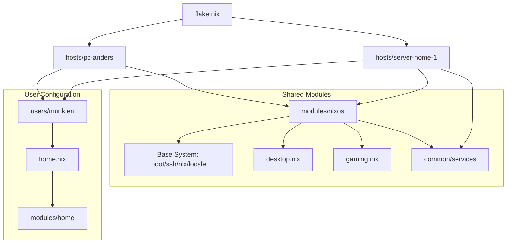

# Munkiens Fleet: Strictly Declarative Multi-Arch NixOS

This repository houses the strictly declarative, multi-architecture configuration for Munkiens' fleet of NixOS machines. It is built upon a stateless root filesystem architecture, modern secrets management, next-generation copy-on-write storage, and advanced performance profiling.

---

## Directory Topology

```
.
├── flake.nix              # DO-NOT-EDIT: auto-generated by flake-file (nix run .#write-flake)
├── outputs.nix            # Flake entrypoint -> flake-parts/
├── flake-parts/           # Flake schema: inputs, hosts, devShell & lint hooks
│   ├── default.nix        #   explicit input declarations + module imports
│   ├── hosts.nix          #   nixosConfigurations + host registry (system/tags)
│   └── shell.nix          #   devShell and pre-commit lint checks
├── modules/               # Reusable modules, auto-imported via import-tree
│   ├── nixos/             #   system-level: boot, disko, tailscale, desktop, gaming, ...
│   └── home/              #   Home Manager: plasma, firefox, developer, terminal, ...
├── common/                # Shared service definitions
│   └── services/          #   arion, caddy, frigate, mosquitto, z2m, homeassistant, ...
├── hosts/                 # Host-specific hardware, layout, and overrides
│   ├── pc-anders/         # Workstation (x86_64, bcachefs multi-tier, Plasma 6)
│   └── server-home-1/     # Home server (x86_64, single-pool bcachefs, Caddy/MQTT/Frigate)
├── users/                 # System user configuration
│   └── munkien/           # User 'munkien' profile, public keys, home-manager payload
├── secrets/               # Encrypted (agenix/agenix-rekey) secrets, per host
└── justfile               # Deployment & maintenance recipes (test/switch/deploy/update)
```

---

## 1. System Architecture & Design Philosophy

The configuration uses a modular, multi-tier layout to separate the universal baseline configuration from host-specific capabilities.



### Flake Structure & Multi-Arch
The fleet is managed using `flake-parts` to provide a clean schema for multi-architecture systems (`x86_64-linux` and `aarch64-linux`).
- **NixOS Configurations**: Evaluated per host in the `flake-parts/hosts.nix` outputs (`nixosConfigurations.pc-anders`, `nixosConfigurations.server-home-1`).
- **Home Manager Configuration**: Exposed via the `home-manager` flake module, and imported into each host through `modules/nixos/home-manager.nix`.

### Fleet-Wide Feature Flags
We declare custom fleet-wide flags in `modules/nixos/options.nix` (and `modules/home/options.nix` for user-scoped flags) within the `my` namespace:
- `my.desktop.enable`: Toggles desktop environments, display managers, graphic stacks, and graphical applications.
- `my.gaming.enable`: Activates gaming optimizations, Steam, GameMode, and GameScope.
- `my.user.developer.enable`: Toggles user-scoped developer tooling (Home Manager).
- `my.user.autostart`: List of applications to autostart in the graphical session.

### NixOS to Home Manager State Bridging
Home Manager configuration in `users/munkien/home.nix` references `osConfig`. This pattern exposes the machine's configuration state to the user's environment:
```nix
home.packages = with pkgs;
  lib.optionals osConfig.my.desktop.enable [
    # Packages are only evaluated and installed if desktop options are enabled on the host
  ];
```
This guarantees that terminal-only headless servers do not waste resources evaluating or installing GUI packages, while maintaining a unified user profile configuration.

---

## 2. Stateless Root & Impermanence

The fleet implements a **strictly stateless root** design. The root directory `/` is mounted as a volatile `tmpfs` RAM disk of `4GB`, which is wiped on every reboot. This forces complete declarative configuration and avoids configuration drift over time.

Because `/etc` is therefore ephemeral, `users.mutableUsers = false` is set
fleet-wide (`modules/nixos/system.nix`): mutable users would write account and
password changes to a filesystem that disappears on reboot. All accounts are
declared in Nix and use `hashedPasswordFile` (agenix).

### Automatic Rollback
A stateless root is disposable, but a host that fails to *boot* still needs a way
back — and a host you cannot walk over to needs one that works without a network.

Two mechanisms, layered:

1. **Automatic Boot Assessment** (`modules/nixos/boot.nix`) —
   `boot.loader.systemd-boot.bootCounting.enable` gives each new generation 3
   boot attempts. Each boot decrements a counter; only when the boot reaches
   `boot-complete.target` does `systemd-bless-boot.service` mark the entry good.
   A generation whose counter reaches zero is skipped in favour of the previous
   one. Entirely local: it works even when the broken generation is itself what
   broke networking.

2. **A health gate** (`modules/nixos/boot-health.nix`) — boot counting alone only
   proves *userspace came up*. A generation that boots cleanly with no default
   route, or with `comin` dead, would be blessed and never rolled back — exactly
   the case that matters for an unreachable host. So `fleet-health-check.service`
   runs before `boot-complete.target` and withholds the blessing unless
   networking, the deploy agent, and (on graphical hosts) the display manager are
   all up.

The dependency direction is deliberate and load-bearing: per `systemd.special(7)`,
`boot-complete.target` carries `Requires=fleet-health-check.service` and is ordered
after it. A plain `WantedBy` would be a *weak* dependency, so a failing check
would leave the target reachable and the generation blessed anyway. Both
properties are asserted by the test suite. `bootCounting.tries` must also stay
below `configurationLimit` (30), or the fallback generation may already have been
garbage-collected from `/boot`.

`systemd-boot` is x86_64-only here, so boot counting applies to x86_64 hosts; the
ARM path uses `generic-extlinux-compatible` and has no automatic fallback.

### The `preservation` Module
We utilize `preservation` (WilliButz/preservation) instead of the traditional `impermanence` module.

#### Why `preservation`?
1. **Granular Attribute-Driven Rules**: `preservation` allows declaring exactly how directories and files should be handled. For example, SSH host keys can be mapped as symlinks (`how = "symlink"`) and registered during the early boot phase (`inInitrd = true`).
2. **Explicit Parent Directory Configuration**: The `configureParent = true` option ensures that the parent directories of preserved files (e.g. `/etc/ssh`) are automatically created with correct permissions.
3. **Mount Ordering Safety**: By binding the activation to `/persist` explicitly and mapping dependencies correctly, `preservation` eliminates race conditions where services try to read credentials or databases before the persistent storage volume is ready.

The global rules in `modules/nixos/preservation.nix` preserve essential system state:
- System directories: `/var/lib/nixos`, `/var/lib/systemd/coredump`, `/var/lib/bluetooth`, `/var/lib/systemd/timers`, `/var/lib/tailscale`, `/etc/ssh`
- Critical files (like `/etc/machine-id` and `/etc/adjtime-id`) are mounted with `inInitrd = true` to preserve system identity across early boot stages.

---

## 3. Storage Topology & Bcachefs Multi-Tiering

All machines use `bcachefs`, the next-generation Linux copy-on-write filesystem. It provides built-in encryption, compression, multi-device tiering, and low-overhead subvolumes (simulated via bind mounts).

### PC-Anders (Multi-Tier Workstation)
The workstation `pc-anders` leverages a heterogeneous physical storage pool composed of NVMe SSDs, SATA SSDs, and HDDs. The layout is mapped in `hosts/pc-anders/filesystem.nix`:

- `/mnt/bcachefs`: The master pool mount point.
- Bind mounts (`/persist`, `/home`, `/nix`, `/var/log`, `/scratch`) point to subdirectories under the master pool.

#### Storage Tier Allocations
We apply performance profiles per subvolume:
- **Metadata**: Double-replicated and pinned to high-speed SSDs (`--metadata_target=ssd --metadata_replicas=2`) for fast file lookup.
- **`/home` & `/persist`**: Writes are foregrounded to SSD, reads are promoted to SSD, and cold data is moved to HDD in the background (`--foreground_target=ssd --promote_target=ssd --background_target=hdd`).
- **`/nix`**: Optimized exclusively for speed. All operations are kept on SSD (`--foreground_target=ssd --promote_target=ssd --background_target=ssd`).
- **`/scratch`**: Configured for large, transient files. Foreground writes go to SATA SSD, cold data is moved to HDD, and read operations are cached on SSD.
- **`/var/log`**: Low priority. Writes go to SATA, reads are cached on SATA, and cold logs reside on HDD.

#### Why the 120s Post-Boot delay for `bcachefs-infrastructure.service`?
Physical block devices in a multi-drive bcachefs pool are registered asynchronously by the kernel.
- If we configure storage target attributes (using `bcachefs set-file-option`) during the initial NixOS activation phase, the command will fail if any of the target physical drives (SSD, SATA, or HDD) have not finished registering.
- To prevent boot failures, we run the configuration as a **delayed systemd service** with a `OnBootSec = 120` timer. This guarantees all disk hardware is fully active and the pool is stabilized before applying storage-tier options.

### Server-Home-1 (Single-Pool Server)
On `server-home-1`, the storage topology is simpler. The system runs global optimizations (lz4 compression, zstd background compression, and safe error fixing) synchronously during the system boot cycle via NixOS `activationScripts`, as there is no multi-device tiering dependency.

---

## 4. Secrets Management & Rekeying Lifecycle

Secrets are encrypted using `agenix` and managed via `agenix-rekey`.

### Why `agenix-rekey`?
Traditional `agenix` setups encrypt secrets using the SSH public keys of both target hosts and users. However, if a host key is rotated or a new system is added to the fleet, every secret must be re-encrypted manually.

`agenix-rekey` automates this lifecycle:
1. Secrets are encrypted using a master identity key (typically a physical SSH key `~/.ssh/id_ed25519`).
2. When the flake environment is built (`nix flake check` or `nix develop`), the flake checks verify the secret encryption.
3. In the dev shell, `agenix-rekey` automatically re-encrypts the secrets for the respective target nodes using the public keys defined in their host directories (`hostPubkey.pub`).
4. This keeps secrets secure in the git repository while decoupling host key rotation from manual secret maintenance.

```
                  ┌───────────────────────┐
                  │   Master Identity     │
                  │   (Private SSH Key)   │
                  └───────────┬───────────┘
                              │ Decrypts
                              ▼
                   ┌─────────────────────┐
                   │  Raw Secret Payload │
                   └──────────┬──────────┘
                              │
             ┌────────────────┴────────────────┐
             ▼ Encrypts                        ▼ Encrypts
   ┌────────────────────┐            ┌────────────────────┐
   │ Host A Pubkey      │            │ Host B Pubkey      │
   │ (hostPubkey.pub)   │            │ (hostPubkey.pub)   │
   └─────────┬──────────┘            └─────────┬──────────┘
             ▼                                 ▼
   ┌────────────────────┐            ┌────────────────────┐
   │ target-secretA.age │            │ target-secretB.age │
   │   (For Host A)     │            │   (For Host B)     │
   └────────────────────┘            └────────────────────┘
```

---

## 5. Desktop Configuration & Performance Tuning

For graphical hosts, the system applies optimizations to ensure low-latency audio, fast desktop response, and reduced CPU/IO overhead.

### Plasma 6 Declarative Configuration
KDE Plasma 6 is configured using `plasma-manager` in `modules/home/plasma.nix`.
- Dual monitors (screen `0` and `1`) share identical, declarative layouts (top widget panel + bottom applications dock).
- KWin blur and transparency effects are enabled with custom strengths (`strength = 12`).

### Resource Collision Avoidance via `mkDelayedStart`
To prevent the login session from stuttering or thrashing the CPU and disks, background user applications are started sequentially using a custom helper:
```nix
mkDelayedStart = name: delay: exec: {
  Unit = {
    Description = "${name} Autostart";
    After = ["graphical-session.target"];
  };
  Service = {
    ExecStartPre = "${pkgs.coreutils}/bin/sleep ${toString delay}";
    ExecStart = "${exec}";
    Restart = "on-failure";
  };
  Install = {WantedBy = ["graphical-session.target"];};
};
```
Heavy packages are systematically delayed: Steam (5s), Spotify (10s), Discord (15s), and Heroic Launcher (20s).

### IO Optimization (Baloo Indexer Tuning)
The KDE file indexer (Baloo) is notorious for resource consumption. We explicitly configure exclusions to prevent Baloo from indexing development environments:
- Excludes directories: `.cache`, `.nix-profile`, `.local/state`, `.cargo`.
- Excludes file types/patterns: `*.nix`, `node_modules`, `build`, `target`, and temporary compiler files.

### Low-Latency Audio Tuning
Pipewire is optimized in `modules/nixos/desktop.nix` with low-latency constraints:
```nix
extraConfig.pipewire."92-low-latency" = {
  "context.properties" = {
    "default.clock.rate" = 48000;
    "default.clock.quantum" = 1024;
    "default.clock.min-quantum" = 32;
    "default.clock.max-quantum" = 2048;
  };
};
```
This forces the audio driver to operate at a stable clock rate of 48kHz and allows it to scale its quantum from 32 to 2048 frames (default 1024), trading latency against underrun safety.

### Priority Scheduling via `ananicy-cpp`
Desktop environments run `ananicy-cpp` (configured with CachyOS optimization rules). This daemon dynamically monitors active processes, boosting the priority (niceness) of games, web browsers, and media players while lowering background compilation jobs.

---

## 6. Developer Workflow & Operations

### Deployment

**Local hosts** use `nh` via the `justfile`:
```bash
just test     # nh os test  — build and activate, rollback unless confirmed
just switch   # nh os switch
```

**Remote hosts** deploy themselves via [`comin`](https://github.com/nlewo/comin), which polls `main` over git and rebuilds locally:
```bash
just deploy   # agenix rekey -a && git push  — hosts pick it up from main
```

There is no central push tool. `main` is therefore the deploy branch: anything merged to it is applied by every host running comin. Rollback on a bad generation is handled locally by systemd-boot Automatic Boot Assessment (see `modules/nixos/boot.nix`), so a host that fails to reach a healthy state falls back to its previous generation without network access.

### Nix Garbage Collection (NH Integration)
Nix generations are managed using `nh` (Nix Helper) in `modules/nixos/nix.nix`.
- System builds auto-cleanup daily via `nh.clean`.
- Configuration retains generations built within the last 7 days, or a minimum floor of 5 generations (`--keep-since 7d --keep 5`).
- The Nix compiler daemon is configured with a nice level of `19` and set to idle I/O class (`IOSchedulingClass = "idle"`) so compilation does not impact desktop interactivity.

### Git Hooks & Lints
To maintain code quality, the repository uses `git-hooks.nix` in the flake check suite:
- **Alejandra**: Enforces opinionated Nix formatting.
- **Deadnix**: Lints and removes unused Nix variables/let-bindings.
- **Statix**: Lints code style and anti-patterns.
- **Check-Symlinks**: Ensures broken symlinks do not slip into configurations.
- **Ripsecrets**: Prevents secrets from being committed in plaintext.

### Tests

`flake-parts/tests.nix` adds a **fleet assertion suite**: evaluation-level checks
that inspect the fully evaluated `nixosConfigurations.<host>.config` and assert
invariants the fleet relies on. They do not boot anything, so they run in seconds
and are cheap enough to gate every push.

```bash
nix build .#checks.x86_64-linux.fleet-assertions-pc-anders
nix build .#checks.x86_64-linux.fleet-assertions-server-home-1
```

Coverage is deliberately split between **relationships** (durable against
intentional config changes) and **explicit guards** (for specific regressions):

| Kind | Examples |
|---|---|
| Fleet invariants | tmpfs root, `/persist` neededForBoot, SSH password auth off, Tailscale and comin enabled |
| Stateless root | `users.mutableUsers = false` (see below) |
| Rollback safety | boot counting on, `tries` within `configurationLimit`, health gate enabled, and the `Requires=`/`Before=` wiring that makes the gate actually block blessing |
| Desktop relationships | graphical ⇒ SDDM + Plasma; headless ⇒ no display manager; gaming ⇒ desktop |
| Server boundaries | home-infra arion services never land on a desktop host; zigbee2mqtt implies a broker |
| Removed options | `my.server.enable` / `my.user.media.enable` cannot silently return |

**`users.mutableUsers = false` is required.** With a tmpfs root, `/etc` is
ephemeral; mutable users would write account and password changes to a filesystem
that disappears on reboot, potentially leaving a host unloggable. All accounts are
declared in Nix and use `hashedPasswordFile` (agenix). This is enforced by the
`stateless-root-requires-immutable-users` assertion.

#### Why not VM tests?

`pkgs.testers.runNixOSTest` would be stronger, but both hosts hardcode real disk
UUIDs and bcachefs multi-device pools in `hosts/*/filesystem.nix`, so a VM cannot
boot them as written. VM boot tests are a follow-on to decoupling the hosts from
their physical disks, not something that can be bolted on alongside them.

#### Known failure: `check-flake-file`

`nix flake check` currently fails on `check-flake-file`, which reports lockfile
pruning drift: it wants duplicate `nixpkgs` / `nixpkgs-lib` nodes collapsed into a
single node, but `nix run .#write-lock` does not emit that, so the check and the
writer disagree. This predates the assertion suite (it fails at commit `a37874b`).

`.github/workflows/checks.yml` therefore treats the fleet assertions and the host
builds as the hard gate, and runs the full `nix flake check` non-blocking
(`continue-on-error`) so it still reports. Once the lockfile drift is fixed, drop
that flag to make the full suite a hard gate.
